<div align="center">



# EXPLORE-CRAFT

**The automation tower-defense RTS — hardened, rebranded, and Windows-ready.**

[](LICENSE)
[](https://adoptium.net/temurin/releases/?version=17)
[](#building)
[](#made-by-aaruto)

</div>

---

## About

EXPLORE-CRAFT is a factory-building game with tower-defense and real-time-strategy elements. Create elaborate supply chains to feed ammo into your turrets, produce materials for building, and construct units. Command units to capture enemy bases, expand your production, and defend your core from waves of enemies.

This project is a hardened fork of [Mindustry](https://github.com/Anuken/Mindustry) by Anuken, rebuilt with a focus on **security, stability, and a smooth native Windows experience**. See [`UPGRADE_PLAN.md`](UPGRADE_PLAN.md) for the full, evidence-backed upgrade record.

## What this fork adds

| Area | Improvement |
|---|---|
| **Mod & script safety** | Path-traversal-safe mod names, escaped script injection, sandboxed `require` roots |
| **Server hardening** | Safer admin/whitelist handling, connection handshake ordering, menu nonce snapshots, bounded command socket, atomic verified updates |
| **Untrusted input parsing** | Bounded save chunks, validated PNG framing before native decode, LZ4 packet body limits, stream/asset transfer budgets, exact-consumption readers |
| **Windows pipeline** | One-command `run-windows.bat` (desktop / server / dist / test / jar), portable JDK 17 support, verified Gradle wrapper |
| **Test coverage** | 421 automated tests plus live client/server smoke suites covering menus, map reload, saves, asset transfer and PNG upload/rejection |

> Resource limits are explicit safety policies, not claims about the original file format. Exceptionally large custom content may be rejected with an explanatory error. Details in [`UPGRADE_PLAN.md`](UPGRADE_PLAN.md).

## Building

Requires **JDK 17** (other versions will not work). Install [Temurin JDK 17](https://adoptium.net/temurin/releases/?version=17) and set `JAVA_HOME`, or place a portable JDK 17 under `jdk/`.

### Windows (one command)

```bat
run-windows.bat dist      REM build desktop + server JARs
run-windows.bat jar       REM run the desktop game
run-windows.bat server-jar REM run the dedicated server
run-windows.bat test      REM run the test suite
```

### Gradle (any platform)

```bash
# Run
./gradlew desktop:run

# Build desktop JAR  -> desktop/build/libs/ExploreCraft.jar
./gradlew desktop:dist

# Build server JAR   -> server/build/libs/server-release.jar
./gradlew server:dist

# Run tests
./gradlew tests:test

# Pack sprites
./gradlew tools:pack
```

On Mac/Linux, if you see `Permission denied`, run `chmod +x ./gradlew` once.

### Where is the `mindustry.gen` package?

`mindustry.gen` is generated **at build time** and is not edited by hand:

- `Call`, `*Packet` classes — generated from methods marked `@Remote`.
- Entity classes (`Unit`, `EffectState`, `Posc`, …) — generated from components in `mindustry.entities.comp` and definitions in `mindustry.content.UnitTypes`.
- `Sounds`, `Musics`, `Tex`, `Icon`, … — generated from files in the respective asset folders.

## Modules

| Module | Purpose |
|---|---|
| `core` | Game logic, content, networking, IO |
| `desktop` | SDL/OpenGL desktop launcher |
| `server` | Headless dedicated server |
| `annotations` | Code generation processors (`mindustry.gen`) |
| `tools` | Sprite packing and asset tooling |
| `tests` | JUnit 5 regression and security suites |

## Attribution & License

EXPLORE-CRAFT is derived from **Mindustry**, created by **Anuken** and contributors, and is distributed under the **GNU General Public License v3.0** — see [`LICENSE`](LICENSE). Upstream project: <https://github.com/Anuken/Mindustry>. All original copyright and license notices are preserved. Internal package names, save-data paths, and the Steam application ID are intentionally retained for compatibility with existing saves and mods.

## Made by AARUTO

Rebranding, security hardening, Windows build pipeline, and verification by **AARUTO**.

<div align="center">

**MADE BY AARUTO**

</div>
